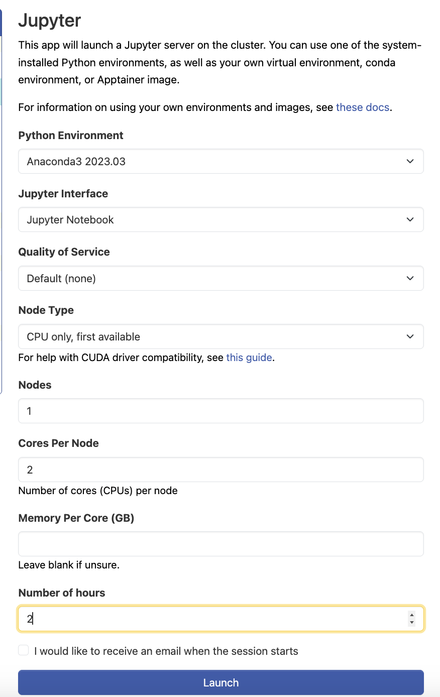
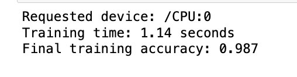
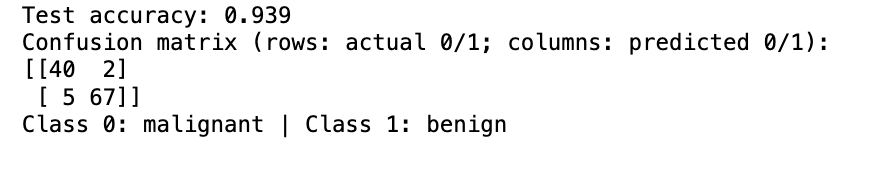
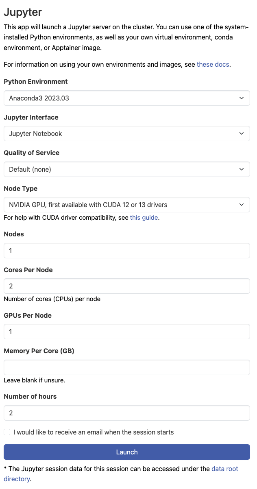
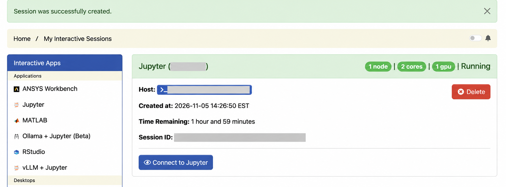
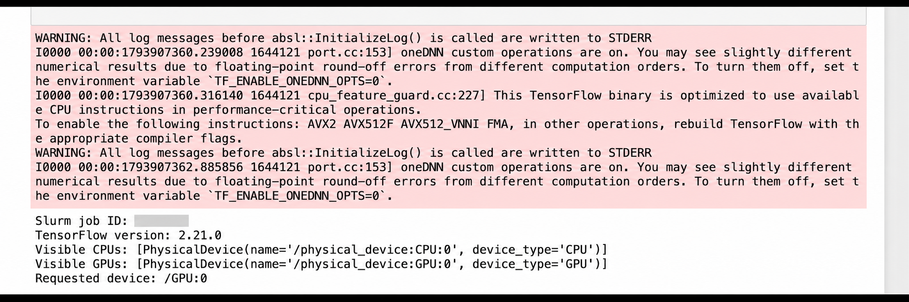
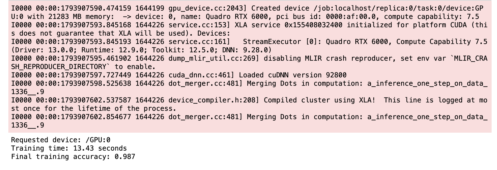
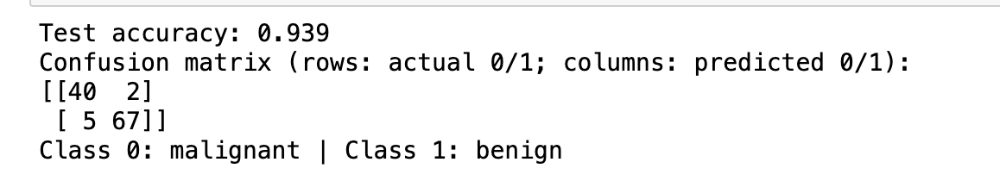

# 405 - Run an ML Notebook on CPU and GPU

This walkthrough uses Jupyter on PACE ICE to train a small neural network twice: once in a CPU session and once in a GPU session. You will check which device TensorFlow can see, run the same notebook in both sessions, and compare the results. The example adapts the breast cancer classification exercise in PACE's *Applications of Machine Learning* workshop. It uses the public Wisconsin dataset bundled with scikit-learn; no private records or separate dataset download are needed.

The point is to learn how an ML workload reaches a compute node. This tiny dataset is **not** a useful GPU speed benchmark. A GPU run can be slower because starting the GPU and moving data have costs too.

## Before you start

- You can connect to the Georgia Tech VPN and sign in to [ICE Open OnDemand](https://ondemand-ice.pace.gatech.edu/). If not, start with [Module 100](../../100%20-%20Access%20and%20Setup/README.md).
- You have room in your ICE storage for a Python environment. The GPU environment may need several gigabytes. See [Storage on ICE](../../300%20-%20Storage%2C%20Troubleshooting%20%26%20Support/301%20-%20Storage%20on%20ICE/301%20-%20Storage%20on%20ICE.md).
- Download the <a href="405%20-%20ML%20on%20ICE.ipynb" download="405 - ML on ICE.ipynb">companion notebook (.ipynb)</a> to your computer. It contains the code used below.

Your course or research group may have its own account, quality of service, or node choices. Use those instructions when they differ from the example here. Check the current [PACE Open OnDemand guide](https://docs.pace.gatech.edu/ood/guide/) if a menu or resource label has changed.

## 1. Launch a CPU Jupyter session

1. Connect to the VPN, open [ICE Open OnDemand](https://ondemand-ice.pace.gatech.edu/), and sign in.
2. Choose **Interactive Apps → Jupyter**.
3. Select **CPU only, first available**, one node, two CPU cores, and two hours. Leave memory per core blank if you are unsure. Choose the account or quality of service assigned to you.
4. Click **Launch**. Wait until the session is running, then click **Connect to Jupyter**.

The Jupyter server should now be running on an allocated compute node. It may sit in the queue before a node becomes available. Do not run the notebook on an ICE login node.



*CPU Jupyter request used for this walkthrough. Your account and available node choices may differ.*

## 2. Prepare the notebook environment

From Jupyter, open a **Terminal**. The menu may say **New → Terminal** or show a launcher tile. Create a virtual environment in your scratch space, if your account has `~/scratch`:

```bash
mkdir -p ~/scratch/haag-ml-demo
cd ~/scratch/haag-ml-demo
python3 -m venv ml-venv
source ml-venv/bin/activate
python -m pip install --upgrade pip
python -m pip install tensorflow scikit-learn ipykernel
python -m ipykernel install --user --name haag-ml-demo --display-name "HAAG ML demo"
```

If `~/scratch` is unavailable, choose a writable directory with enough space and use that path instead. The install may take a few minutes. If `python3 -m venv` is unavailable in the Jupyter environment, choose a current Python/Anaconda option in the Jupyter launch form and try again. Avoid an old module version just because it appears in the original workshop notes.

In Jupyter's file browser, open **scratch → haag-ml-demo** and upload the companion `.ipynb` file. Open it and select the **HAAG ML demo** kernel. In the first code cell leave `RUN_ON = "CPU"`, then choose **Cell → Run All**. The first code cell should show `Visible GPUs: []` and `Requested device: /CPU:0`. TensorFlow may print CUDA initialization messages in a CPU session; those messages do not mean the CPU run failed.

The training and test cells should print results like these:





*The CPU run in this walkthrough took 1.14 seconds to train and reached 0.939 test accuracy. Your timing may differ.*

## 3. Run it again with a GPU

Save the notebook and delete the CPU interactive session in Open OnDemand before requesting a GPU. Return to **Interactive Apps → Jupyter**. For this walkthrough we selected **NVIDIA GPU, first available with CUDA 12 or 13 drivers**, one node, two CPU cores, one GPU, and two hours. Use the account and quality of service assigned to you.



*GPU Jupyter request used for this walkthrough.*

Wait for the session status to change to **Running**, then click **Connect to Jupyter**.



In Jupyter, open a Terminal and run `nvidia-smi` to confirm that your session can see a GPU. Our session received a Quadro RTX 6000; yours may receive another model.

Activate the same virtual environment and add TensorFlow's GPU dependencies:

```bash
source ~/scratch/haag-ml-demo/ml-venv/bin/activate
python -m pip install 'tensorflow[and-cuda]'
python -c "import tensorflow as tf; print(tf.config.list_physical_devices('GPU'))"
```

The last command should list at least one GPU. If it prints `[]` while `nvidia-smi` shows a GPU, use the [GPU troubleshooting steps](#the-gpu-list-is-empty) below before running the notebook in GPU mode.

Open the notebook with the **HAAG ML demo** kernel, change the first code cell to `RUN_ON = "GPU"`, and choose **Kernel → Restart**. Run the first code cell. Continue only if it lists a visible GPU and prints `Requested device: /GPU:0`.



Then choose **Cell → Run All**. The notebook stops if no GPU is visible when GPU mode is selected. TensorFlow may still run some operations, including data loading, on the CPU. The visible GPU and TensorFlow's device initialization message confirm that the GPU is available to the model, but the reported device alone does not prove that every operation ran on it.





*Our GPU run took 13.43 seconds to train and reached 0.939 test accuracy. The pink TensorFlow messages above the result are startup logs, including confirmation that it created a Quadro RTX 6000 device.*

## 4. Compare and clean up

These are the results from our ICE run. Your exact times and results may differ:

| Check | CPU session | GPU session |
|---|---|---|
| Slurm session started on a compute node | Yes | Yes |
| TensorFlow device reported by notebook | `/CPU:0` | `/GPU:0` |
| Training accuracy | 0.987 | 0.987 |
| Test-set accuracy | 0.939 | 0.939 |
| Model training time | 1.14 seconds | 13.43 seconds |

Both runs had the same test accuracy and confusion matrix (`[[40, 2], [5, 67]]`). The GPU session took longer; startup and compilation overhead likely contributed because this model and dataset are small. Timing may also vary with the node and software versions. Do not conclude that a GPU is always faster or slower from this one small run. When finished, **delete or stop both interactive sessions** in Open OnDemand so the allocated resources are released. Keep the notebook and any notes you want; remove the virtual environment later if you no longer need it.

## If something goes wrong

- **Jupyter stays queued:** Shorten the wall time or try another permitted node type. Do not switch to a different account or quality of service without permission.
- **The kernel is missing:** In a Jupyter Terminal, activate the environment and rerun the `ipykernel install` command. Refresh Jupyter's browser tab.
- **Training says `RangeDataset` cannot run on GPU:** Use the current companion notebook, which sets `tf.config.set_soft_device_placement(True)`. TensorFlow can then run the input pipeline on the CPU while using the GPU for supported model operations.
- **Storage is full:** Check your usage before installing more packages; see [Module 300](../../300%20-%20Storage%2C%20Troubleshooting%20%26%20Support/README.md).

### The GPU list is empty

If TensorFlow prints `[]`, first check that the Jupyter session requested a GPU and `nvidia-smi` can see it. A GPU allocation alone does not guarantee that TensorFlow can find its CUDA libraries.

If `nvidia-smi` works, activate the virtual environment and try the library links in the [TensorFlow GPU installation guide](https://www.tensorflow.org/install/pip):

```bash
source ~/scratch/haag-ml-demo/ml-venv/bin/activate
pushd "$(dirname "$(python -c 'print(__import__("tensorflow").__file__)')")"
ln -svf ../nvidia/*/lib/*.so* .
popd
python -c "import tensorflow as tf; print(tf.config.list_physical_devices('GPU'))"
```

If that check still prints `[]`, add the installed CUDA library directories to the **HAAG ML demo** Jupyter kernel. This second step was needed in our ICE session:

```bash
python - <<'PY'
import glob
import json
import os
import sysconfig
from pathlib import Path

kernel = Path.home() / ".local/share/jupyter/kernels/haag-ml-demo/kernel.json"
spec = json.loads(kernel.read_text())
root = sysconfig.get_paths()["purelib"]
paths = glob.glob(f"{root}/nvidia/*/lib")
spec.setdefault("env", {})["LD_LIBRARY_PATH"] = ":".join(
    paths + [os.environ.get("LD_LIBRARY_PATH", "")]
)
kernel.write_text(json.dumps(spec, indent=2) + "\n")
print("Configured", len(paths), "CUDA library paths for the Jupyter kernel")
PY
```

Restart the **HAAG ML demo** kernel and rerun the notebook's first code cell. Continue with the GPU run only when it lists a visible GPU and prints `Requested device: /GPU:0`.

This lesson is based on the provided [PACE Applications of Machine Learning workshop](https://github.com/jeffvaldez/PACE-Apps-of-ML). Its notebook uses the same dataset and general classification workflow, but this shorter example is focused on requesting and verifying CPU and GPU resources on ICE.
